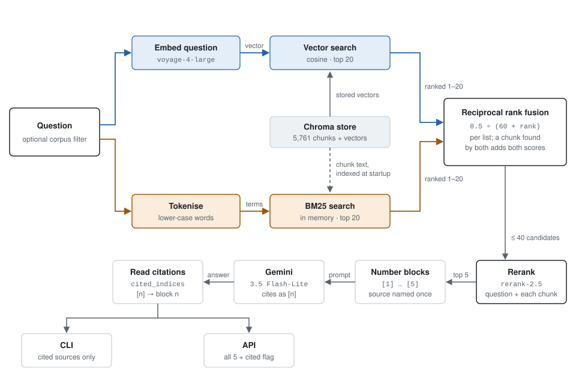

# Monster Hunter RAG

A retrieval-augmented generation pipeline that answers questions about the Monster Hunter
game series using a corpus built from wikipedia articles, and content from the [Monster Hunter Wiki](https://monsterhunterwiki.org/wiki/Main_Page).
Questions are answered only from the retrieved source material. Each statement cites the numbered
passage it came from, only the cited sources are listed, and the system says "I don't know" rather
than falling back on the language model's own knowledge. An optional agent mode lets the model run
its own searches, for questions with more than one part.

Built with LangChain, Voyage AI embeddings and reranking, BM25 keyword search, Chroma as a
persistent vector store, and Gemini 3.5 Flash-Lite for free generation with a high rate limit.

## Example

The same two-part question in both modes. The pipeline searches once with the question as asked:

```
>The first Monster Hunter game was released on which console, and when did that console launch in Japan?

The first Monster Hunter game was released on the PlayStation 2 [1][2]. The context does not provide the launch date of the PlayStation 2 console in Japan.

Sources:
  [1] Monster_Hunter_(video_game)   relevance=0.8398 - wikipedia_pages
  [2] Monster_Hunter                relevance=0.7969 - wikipedia_pages
```

Agent mode (`--agent`) searches for the console first, then for that console's launch:

```
>The first Monster Hunter game was released on which console, and when did that console launch in Japan?

Searched:
  1. "Monster Hunter first game release console" (all corpora)
  2. "PlayStation 2 release date Japan" (all corpora)

The first Monster Hunter game was released on the PlayStation 2 [1], which launched in Japan on March 4, 2000 [6].

Sources:
  [1] Monster_Hunter_(video_game)   relevance=0.8639 - wikipedia_pages
  [6] PlayStation_2                 relevance=0.9375 - wikipedia_pages
```

Reading the output:
- Each statement ends with the numbers of the passages that support it.
- `Sources` lists only the cited passages, under the same numbers. Each search retrieves five
  passages, and the API returns all of them, each marked `cited` true or false.
- In agent mode, `Searched` lists the queries the model wrote. Passage numbers continue across
  searches, so [6] is the first passage of the second search.
- `relevance` is the reranker's score for that passage against the query that found it.

## Pipeline

Before any question is asked, ingestion loads one document per article from the corpus JSON
files, splits it at section, paragraph and sentence ends, drops heading-only chunks, embeds the
rest with Voyage and stores them in Chroma under content-hash IDs. Each question then takes this path:

<picture>
  <source media="(prefers-color-scheme: dark)" srcset="docs/retrieval-pipeline-dark.svg">
  
</picture>

## Results

Evaluated on 60 labelled questions (`evaluation/questions.json`): monster and Wikipedia facts,
paraphrased descriptions, look-alike monsters, exact keywords such as Japanese names, two-part
questions, and out-of-scope questions that should get "I don't know". Each change was measured
before the next; every run is saved in `evaluation/results`.

| Run | Change | Reranked hit@1 | hit@5 | Answers | Citations |
|---|---|---|---|---|---|
| `baseline-v2.json` | Extended question set | 0.95 | 0.98 | 0.93 | – |
| `citations.json` | Inline `[n]` citations, prompt fixes | 0.95 | 0.98 | 0.92 | 0.92 |
| `chunking.json` | Sentence-aware splitting, heading filter | 0.96 | 0.98 | 0.93 | 0.95 |
| `hybrid.json` | BM25 keyword search fused with vector search | 0.98 | 1.00 | 0.95 | 0.97 |
| `pipeline.json` | Current pipeline | 0.98 | 1.00 | 0.95 | 0.97 |
| `agent.json` | Agent mode | – | – | **1.00** | 0.97 |

- **Hit@k** is the share of questions with an expected page in the top k passages after reranking.
  Agent mode has no single ranked list; it found an expected page for every question.
- **Answers** contain the expected terms, or refuse an out-of-scope question. All rows are scored
  against the current labels from their saved answers, so they're comparable.
- **Citations** cite an expected page, or nothing for an out-of-scope question.
- One question is worth almost two points, and Flash-Lite's answers vary slightly between runs, so
  differences of 0.02 are noise.

Pipeline against agent mode on the same questions:

| | Pipeline | Agent mode |
|---|---|---|
| Answers correct | 57 of 60 | 60 of 60 |
| Two-part questions | 1 of 4 | 4 of 4 |
| Gemini calls | 60 | 123 (at most 3 for one question) |
| Searches | 60 | 65 (two for each two-part question) |

The agent fixed all three questions the pipeline gets wrong: the console-and-launch-date question
above, "Which was introduced first, Tigrex or Nargacuga?" (the pipeline said "I don't know"), and
"Which is weak to Thunder: Zinogre or Nargacuga?" (the pipeline said both). It never reached its
limit of four searches. Its citation misses were a correct answer with no citation, and one
answer citing related monsters' pages instead of the expected one, which the pipeline also did.

## Problems worth describing

### Empty section headings polluted the corpus
Headings were written out as lines of their own, so a section with no prose beneath it left a
bare heading behind. On monsterhunterwiki.org this was common: many sections hold only stat
tables or galleries, which the scraper strips, leaving runs of consecutive headings. The
splitter turned these into chunks with nothing to retrieve, in both corpora.

Filtering on the text alone cannot reliably tell a heading from a short sentence, so the fix
uses the page structure. When scraping the HTML, a heading is held back and written only once
a prose block follows it; if another heading arrives first, it replaces the held one. The
Wikipedia plain-text extracts have no HTML to use, so the chunker drops chunks made only of
headings, as described below.

### Short facts were lost to the length filter
The first fix for bare headings dropped every chunk under 80 characters. Of the 209 chunks it
removed, 190 were headings, but the rest were real sentences, some found nowhere else in the
corpus: "the Gore Magala is genderless", "Bleem! were subsequently forced to shut down in
November 2001". They were short because the splitter, when breaking a long paragraph at a
sentence boundary, attached the ". " separator to the next piece, leaving tails such as
". After Ratha comes to his senses..." as chunks of their own.

The splitter now keeps each separator with the sentence it ends, and the length filter was
replaced by one that recognises headings by shape: short lines with no punctuation. The first
version of that rule would have dropped all 471 monster infobox chunks, since lines like
"Weakest To: Thunder" are just as short and unpunctuated; counting a colon as content fixed it,
and a test now guards against it.

### Duplicate chunk IDs rejected on ingestion
Chunk IDs are a hash of each chunk's corpus, source page and text, so re-running ingestion
skips chunks already stored. When a page repeats a passage verbatim, two chunks produce the
same ID. Both passed the check against the store, since neither was stored yet, and Chroma
then rejected the entire batch for containing a duplicate ID. Ingestion now also tracks the
IDs seen within the batch and keeps only the first copy, which loses nothing because the
text is identical.

## Setup

```bash
conda create -n MH_RAG python=3.11
conda activate MH_RAG
pip install -r requirements.txt
```

Versions are pinned to the ones every evaluation in `evaluation/results` ran on. Two extra files
cover the rest: `requirements-dev.txt` adds pytest and ruff, which CI runs on every push, and
`requirements-corpus.txt` adds the scraping packages that `notebooks/build_corpus.ipynb` needs.
`pip install -e .` installs the `rag` package itself, so its commands also work from outside the
repository.

Create a `.env` in the repository root containing API_KEY variables:

```
VOYAGE_API_KEY=your_key
GOOGLE_API_KEY=your_key
```

Both have usable free tiers:
- Voyage provides 200 million free tokens for embedding and reranking. Building the full vector store costs ~620k tokens with `voyage-4-large`, 0.3% of the allowance, so it can be rebuilt many times over at no cost.
- Gemini 3.5 Flash-Lite's free tier is rate limited, so use `--retrieval-only`
(below) when iterating on retrieval.

## Running
Commands run from the repository root, or from anywhere after `pip install -e .`.

Interactive question answering: First run embeds the full corpus; later runs reuse the persisted store and starts immediately.

```bash
python -m rag.pipeline
```

Retrieval only, showing which chunks are returned and their re-ranking relevance scores, without calling the
language model:

```bash
python -m rag.pipeline --retrieval-only
```

Search one corpus only, `wikipedia_pages` (series and sales history) or `mh_wiki_monsters`
(in-game monster data). Combines with `--retrieval-only`:

```bash
python -m rag.pipeline --corpus mh_wiki_monsters
```

Agent mode: the model writes its own searches, as many as it needs up to four, before answering.
It lists the searches above the answer. Slower, and uses about two LLM calls per question instead
of one (up to five), so it suits comparisons and questions with more than one part. Combines with
`--corpus`:

```bash
python -m rag.pipeline --agent
```

```
>Which was introduced first, Tigrex or Nargacuga?

Searched:
  1. "Tigrex debut game" (all corpora)
  2. "Nargacuga debut game" (all corpora)

Tigrex was introduced first, debuting in Monster Hunter Freedom 2 [4], while Nargacuga was introduced later in Monster Hunter Freedom Unite [7].

Sources:
  [4] Tigrex      relevance=0.6658 - mh_wiki_monsters
  [7] Nargacuga   relevance=0.6445 - mh_wiki_monsters
```

API, with the interactive docs at `http://localhost:8000/docs`. `corpus` and `agent` are optional;
with `"agent": true` the response also lists the searches made. If Voyage or Gemini fails, `/query`
returns 503 with a plain message, saying so when the free tier is rate limiting:

```bash
uvicorn rag.api:app
curl -X POST localhost:8000/query -H "Content-Type: application/json" \
     -d '{"question": "What is Rathalos weak to?", "corpus": "mh_wiki_monsters"}'
curl -X POST localhost:8000/query -H "Content-Type: application/json" \
     -d '{"question": "Which was introduced first, Tigrex or Nargacuga?", "agent": true}'
```

Evaluation against the labelled questions in `evaluation/questions.json`. Retrieval is scored
by hit rate and MRR before and after reranking, using only Voyage calls; `--generate` also checks
each LLM answer for the expected terms, or for a refusal on out-of-scope questions:

```bash
python -m rag.evaluate
python -m rag.evaluate --generate --output evaluation/results/my-run.json
python -m rag.evaluate --retrieval vector     # compare against vector search alone
python -m rag.evaluate --agent --output evaluation/results/agent.json
```

`--agent` scores agent mode on the same questions: answers and citations as above, whether an
expected page was among the passages it saw, and the searches and LLM calls it spent. It pauses
longer after questions that made more calls, to stay within the free tier.

Saved runs are in `evaluation/results`, each with the settings it ran on; the [Results](#results)
section summarises them. `baseline.json` predates the extended question set and covers only the
original 42 questions, so compare new runs against `pipeline.json` and `agent.json`.

Tests and lint. The tests use fakes in place of the APIs, so they need no keys:

```bash
python -m pytest tests -q
ruff check rag tests
```

## Repo layout

```
rag/
    config.py       paths, models, and hyperparameters in one place
    ingest.py       loads the JSON corpus into Documents
    chunking.py     splitting and the heading-only filter
    vectorstore.py  embeddings, Chroma, deduplication, retriever, reranker
    chain.py        prompt, language model, and the LCEL retrieval chain
    pipeline.py     orchestration and command-line entry point
    api.py          FastAPI serving layer
    agent.py        agent mode: a search tool and the loop that lets the model use it
    evaluate.py     retrieval and answer scoring on the labelled questions
docs/               pipeline diagram, light and dark versions
documents/          the corpus as JSON files
evaluation/         labelled questions with expected source pages and answer terms
notebooks/
    build_corpus.ipynb  fetches both sources and writes the corpus JSON files
    archive/            earlier exploration notebooks, kept for reference
tests/              unit tests, with fakes standing in for the APIs
.github/workflows/  CI: ruff and pytest on every push
```

## Data

The corpus is composed from two sources totalling 505 documents. It is committed in
`documents/`, so a clone can build the vector store straight away, and it can be rebuilt
from source by running `notebooks/build_corpus.ipynb`. Monster Hunter Wiki pages
are selected by category; the Wikipedia articles are a fixed list of titles in
the notebook, since the consoles and sales list sit outside the series category.

The first is 33 English Wikipedia articles covering the Monster Hunter series,
its individual titles and spin-offs, the consoles they released on, and a list
of best-selling video games. This provides meta-information about the series.

The second is 472 pages from monsterhunterwiki.org, providing in-game content.
The two sources answer different question types, and chunks record which corpus
they came from so retrieval results can be attributed and filtered.

Both are fetched via the MediaWiki API. Wikipedia supports plain-text extracts
directly, whereas monsterhunterwiki.org pages are requested as rendered HTML and
reduced to prose by stripping empty headings and non-textual elements. Infobox
tables are read separately into label-value lines before the surrounding tables
are discarded, since they hold attributes worth retaining such as
classification, elements, and elemental weaknesses. Those values are rendered as
icons whose names appear on the parent link rather than in the image, so they
are recovered from the link rather than the image text.

Reference, External links, and See also sections are stripped at fetch time,
along with headings left empty once their tables were removed, MediaWiki
citation errors, and stub pages whose only content was the legend explaining the
stat tables.

`documents/wikipedia_pages.json` and `documents/mh_wiki_monsters.json` map page
titles to their plain text. The vector store in `chroma_db/` is generated from
them and is not committed, since it is reproducible from the corpus and the
ingestion code. A `.gitkeep` file retains the folder structure.

## Design decisions

**Content-hash chunk IDs.** Each chunk's ID is a SHA-256 hash of its corpus, source article and
text, so an unchanged chunk (same `CHUNK_SIZE`, `CHUNK_OVERLAP`) always produces the same ID. Re-running 
ingestion embeds only chunks not already stored, which means adding one article to the corpus costs only that
article's embeddings rather than a full rebuild.

**Persistent vector store.** Chroma writes to disk, so embeddings survive process
restarts.

**Fixed-size chunking over semantic chunking.** All articles are already cleanly
sectioned, so semantic chunking's advantage is modest here, while it costs an additional
embedding pass over every sentence to determine boundaries. The splitter is configured to
prefer section and paragraph boundaries before falling back to more arbitrary cuts.

**Headings filtered by shape, not length.** A chunk is dropped only when every line looks like a
heading: short, with no punctuation. Short sentences and infobox lines such as "Weakest To:
Thunder" are kept. The problem write-up above explains why a length cut-off wasn't enough.

**Inline citations.** Passages reach the model numbered [1] to [5], and it cites the ones it
used after each statement. Only cited sources are listed under the answer, so a reader sees
what supports it rather than everything that was retrieved; the API returns all five with a
`cited` flag. Evaluation scores citations separately from answers, since a correct answer can
cite the wrong page.

**Model choice and temperature.** Gemini 3.5 Flash-Lite is used for its speed and its larger
free allowance; Gemini 3.8 Flash, the newest free model, allows only 20 requests a day, fewer than
one evaluation run needs. Flash-Lite uses fixed sampling and ignores the temperature setting, so
the same question can get slightly different answers between runs, and small differences between
evaluation runs are noise. `LLM_TEMPERATURE = 0` stays in `config.py` for models that honour it,
such as Gemini 3.5 Flash, where it would make evaluation runs repeatable.

**Retrieval and serving are separated.** `chain.py` contains no ingestion or storage
logic, so the serving layer imports it without triggering corpus loading. The chain is
built once at application startup rather than per request.

**Reranking over a larger candidate set.** Retrieval returns up to 40 candidates so the
reranker has enough to work with. Reranking improves precision within a candidate set but
cannot recover a relevant chunk that the initial retrieval missed entirely.

**Hybrid retrieval.** Embeddings place a question near passages with similar meaning, which
fails for rare exact terms: asked which monster is called "Arushuberudo" in Japanese, vector
search ranked the Arkveld page 7th and the reranker dropped it. BM25 keyword search over the
same chunks finds such terms directly, and the two ranked lists are merged by reciprocal rank
fusion before reranking. On the evaluation set this raised reranked hit@1 from 0.96 to 0.98
and keyword questions from 0.80 to 1.00, with no category getting worse. The BM25 index is
built in memory from the stored chunks at startup. `HYBRID_SEARCH` in `config.py` turns it off.

**Agent mode as an option, not the default.** The pipeline searches once, with the question as
asked. That fails when a question has two parts: for "Which was introduced first, Tigrex or
Nargacuga?" four of the five passages came from Tigrex pages, and for "the first game's console,
and when it launched in Japan" the second search depends on the first answer. Agent mode gives
the model a search tool over the same hybrid search and reranker; it writes a query per subject,
reads the results, and searches again or answers, up to `AGENT_MAX_SEARCHES` times. Passages are
numbered across all its searches, so citations work as in the pipeline. It's built on LangChain
tool calling without an agent framework, since one tool and a fixed limit need no more. On the
evaluation set it answered all 60 questions correctly against 57 for the pipeline, fixing every
two-part question, but used 123 Gemini calls instead of 60. Single-fact questions already score
1.00 in the pipeline at half the cost, so agent mode is opt-in.

## Limitations and next steps

**Evaluation is keyword-based and the question set is small.** `rag.evaluate` scores
retrieval against labelled source pages and checks answers for expected terms, which avoids
an LLM judge and stays within free tiers. Term matching cannot judge paraphrased answers: two
correct answers ("highly intelligent", "lacks any determinable sex") were scored wrong until
their labels accepted those wordings. An LLM-as-judge framework such as RAGAS would handle
this, at the cost of more calls than Gemini's free tier allows. Term matching can also accept a
wrong answer that contains the right name, so labels can list excluded terms: "Which is weak to
Thunder: Zinogre or Nargacuga?" rejects answers saying "both". With 60 questions, one question is
worth almost two points of accuracy, so small differences between runs are noise. Agent mode now
answers every question correctly, so the set can no longer tell changes to it apart; harder
multi-part questions would be needed to measure further work on it.

**No caching layer.** Caching both common queries and their generated answers would avoid
repeat API calls, reducing latency and token consumption.

## Completed

**Corpus rebuildable from source.** The rough ingestion code for the Wikipedia and
MonsterHunterWiki.org APIs was consolidated into `notebooks/build_corpus.ipynb`, which
writes both JSON files and reports what changed against the previous version. The
exploration notebooks it replaced are kept in `notebooks/archive/`.

**Sources returned with every answer.** The chain passes the reranked documents through
alongside the answer, so the CLI and API list each source's title, corpus and relevance
score rather than discarding them after formatting the context.

**Retrieval-only mode.** `--retrieval-only` shows the fused candidates and the reranked
passages with their relevance scores without calling the LLM, so retrieval quality can be
diagnosed without consuming generation quota.

**Reproducible setup.** Dependencies are pinned, the corpus is committed, and
`pyproject.toml` makes the package installable, so a fresh clone installs the same versions
the evaluations ran on and works without rebuilding the corpus first.

**Test coverage and CI.** The tests cover loading, chunking, ID generation, deduplication,
stale-chunk removal, context formatting, the API's responses and the evaluation scoring, all
without API calls. GitHub Actions runs them, with ruff, on every push.

**In-game content.** The original sources covered only development and commercial history.
Monster pages from monsterhunterwiki.org now allow questions about the games themselves
rather than just the metadata surrounding them.
